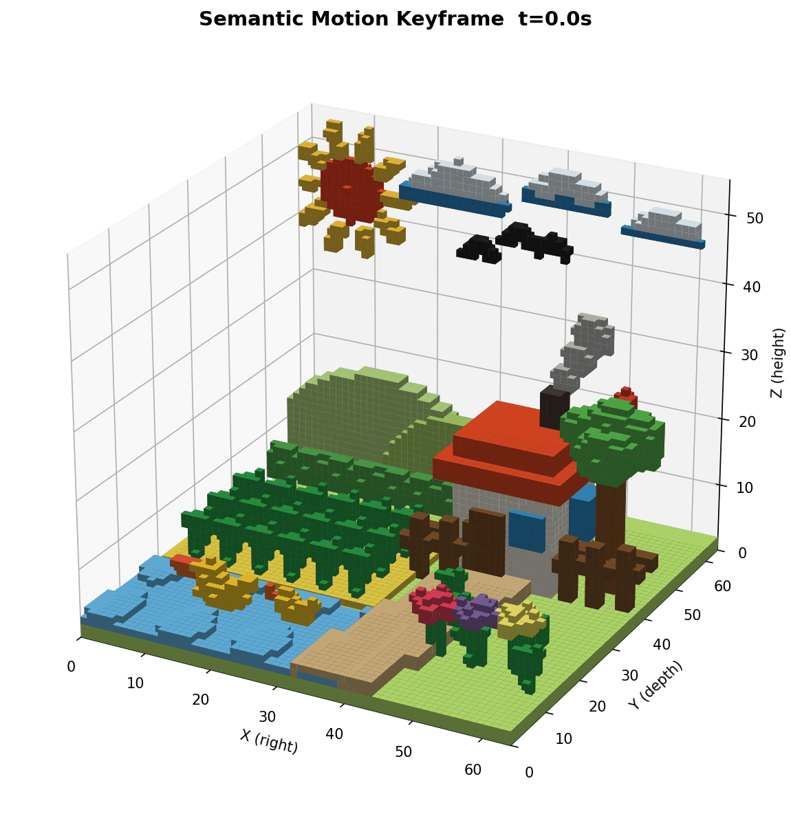
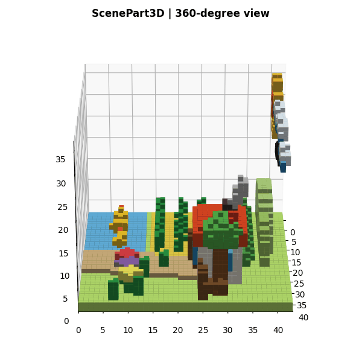
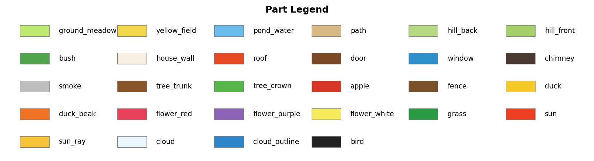

# ScenePart3D

**From a 2D illustration to a part-aware 3D scene.**

| 2D input | Generated 3D scene (semantic motion preview) |
| :---: | :---: |
|  |  |

ScenePart3D generates a structured, part-aware 3D scene from a single 2D image. The example above shows the input drawing alongside a voxel rendering of the resulting scene. The animation previews semantic motion applied to its parts.

## 360-degree scene preview

This slow, 9-second rotation shows the reconstructed voxel scene from all directions.

  

## Fine-grained scene visualization

The legend below shows the semantic part labels and colors used in the reconstructed scene.

  

## Repository status

We are organizing the code, documentation, and examples for release.
